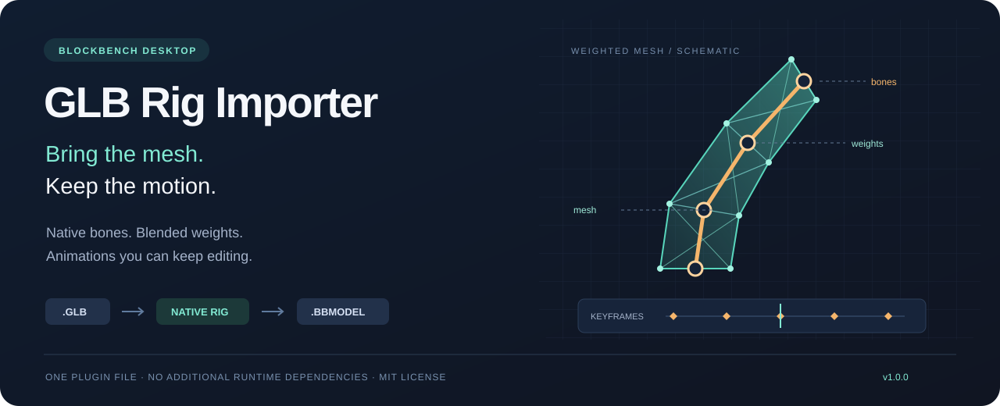

<p align="center">
  
</p>

<h1 align="center">GLB Rig Importer for Blockbench</h1>

<p align="center">
  Import a GLB character with its skeleton, vertex weights, textures and animations.<br>
  Keep editing with native Blockbench tools. Save a portable <code>.bbmodel</code>.
</p>

<p align="center">
  
  
  
  
</p>

<p align="center">
  <a href="#install">Install</a> ·
  <a href="#what-makes-it-useful">Features</a> ·
  <a href="#compatibility">Compatibility</a> ·
  <a href="docs/AUTOMATION.md">Automation & AI agents</a> ·
  <a href="docs/VALIDATION.md">Validation</a>
</p>

## Why this exists

I needed to bring an animated GLB character into Blockbench, adjust its poses and create new animations while keeping the original weighted mesh. That workflow needed a direct path from a GLB file to an editable native rig. This plugin grew out of that need, and I am sharing it so other developers and artists can use the same path.

**GLB → native armature + weighted meshes + editable animations → BBMODEL.**

The focus is skeletal import: `Armature` and `ArmatureBone` objects, vertex weights and native animation tracks. The resulting project remains usable after saving and reopening it without this plugin.

## What makes it useful

| Capability | What you get |
| --- | --- |
| **Native skeletal rig** | Editable Blockbench armatures and bones, with source node hierarchy and bind-matrix corrections. |
| **Weighted deformation** | Up to four joint influences per vertex; imported weights are normalized. |
| **Editable animation** | Source translation, rotation and scale tracks converted into native position, rotation and scale keys. |
| **Textures and UVs** | Embedded images, primary UV coordinates and base-color textures or generated color swatches. |
| **Portable projects** | Save as `.bbmodel`; the saved rig does not require the importer to reopen. |
| **Single-file install** | One JavaScript file, using Blockbench's built-in APIs and Three.js. No separate server, Blender or MCP setup required. |
| **Automation entry point** | A documented `window.GlbRigImporter.importFile(file, options)` API for scripts and AI-assisted workflows. |

Animations are sampled at source key times and an additional configurable grid, **120 FPS by default**. This makes quaternion-based source motion editable as Euler keys in Blockbench. It is an approximation between keys; higher sampling rates increase project size and import time.

## Install

Requires **Blockbench desktop 5.0 or newer** with native armature APIs. The existing character workflow was validated on **5.2.2**; other versions have not been exhaustively tested.

1. Download or clone this repository and locate [`plugin/glb_rig_importer.js`](plugin/glb_rig_importer.js).
2. In Blockbench, open **File → Plugins**.
3. Choose **Load Plugin from File** and select `glb_rig_importer.js`.
4. Open **File → Import → Import GLB with Rig and Animations…**.

You can also drag a `.glb` file into the editor after installing the plugin. While the repository is private, use an authenticated clone or download; an anonymous raw-file URL will not work.

## First import

Try the original, MIT-licensed [`examples/weighted-ribbon.glb`](examples/weighted-ribbon.glb): a small two-joint ribbon with blended weights, an embedded texture and a `Sway` animation. Its source generator is included; no third-party character asset is required.

1. Save any current work, then choose the GLB file.
2. Set **Coordinate scale**. The default is `16`; GLB coordinates are multiplied by this number.
3. Set **Animation sampling FPS**, from `1` to `240`. Start with `120`.
4. Import into a separate **Generic Model** tab.
5. Open **Animate**, select a clip and play or edit it.
6. Save as `.bbmodel` and reopen it to check your workflow.

The example is two source units tall, so importing at scale `16` produces a ribbon about 32 Blockbench units tall. Real assets may use very different source scales.

## Compatibility

| Input feature | Support |
| --- | --- |
| Binary glTF 2.0 (`.glb`) | Yes, with a self-contained binary buffer. Text `.gltf` is outside this plugin's scope. |
| Triangle meshes | Indexed and non-indexed triangles; multiple mesh primitives. |
| Skeletal skinning | `JOINTS_0` / `WEIGHTS_0`, up to four influences per vertex. |
| Rigid mesh animation | Node transforms represented through bones with full vertex influence. |
| Animation interpolation | Source `LINEAR`, `STEP` and `CUBICSPLINE` sampled into linear native keys. Exact discontinuities are not preserved. |
| Embedded textures | Buffer-view images or data URIs readable by Blockbench, primary `TEXCOORD_0`. |
| Materials | Base-color texture or a color swatch, plus double-sided rendering. Full PBR fidelity is not provided. |
| External buffers or images | Unsupported; pack resources into the GLB first. |
| Draco / Meshopt compression | Unsupported; export uncompressed geometry and buffers. |
| Morph targets / blend shapes | Unsupported, including morph-weight animation. |
| Cameras, lights, extra UV sets | Not imported as their corresponding native features. |
| Shared joints with different bind matrices | Rejected. |
| Required extensions | Only `KHR_materials_specular` and `KHR_materials_unlit` are allowlisted; this is not a promise of full material rendering fidelity. |

The importer processes the file's node list rather than filtering to the active glTF scene. Complex transforms involving shear, unusual bind setups and large multi-skin assets need additional validation. No universal “every GLB imports perfectly” guarantee is made.

GLB does not specify animation loop behavior. Imported clips default to looping; change this in Blockbench when needed. Imported source normals and the full glTF material system are not preserved; meshes use Blockbench smooth shading.

## For developers and AI agents

**Search terms:** Blockbench GLB importer, glTF skeletal import, armature import, vertex weights, skinned mesh, editable skeletal animation, GLB to BBMODEL.

Start with [`llms.txt`](llms.txt) for a compact project map, [`docs/AUTOMATION.md`](docs/AUTOMATION.md) for the scripting contract, and [`AGENTS.md`](AGENTS.md) for contribution instructions. These files make the capabilities and limits explicit; they do not guarantee discovery or indexing by any particular AI service.

```js
// Run inside the Blockbench desktop renderer after loading the plugin.
Blockbench.read([absoluteGlbPath], {readtype: 'buffer'}, async files => {
    try {
        const result = await window.GlbRigImporter.importFile(files[0], {
            scale: 16,
            fps: 120,
        });
        console.log('GLB import complete.', result);
    } catch (error) {
        console.error('GLB import failed.', error);
    }
});
```

This is an editor API, not a headless Node.js converter. An MCP bridge can invoke it if the bridge supports renderer script execution, but no bridge is bundled or required.

## Validation

The original character import was checked after saving and reopening the BBMODEL: **1,143 vertices, 1,372 triangles, 41 source joints and five animation clips**, with two additional transform nodes represented as bones. The recorded maximum vertex error was below `0.064` Blockbench units at scale `1800` and 120 FPS; weight error was below `0.000005`.

These are measurements for one asset, not general accuracy bounds. See [the validation method and recorded report](docs/VALIDATION.md). The original character and its images are not redistributed here.

Run the standalone decoder, interpolation and plugin-contract tests with **Node.js 22+**:

```sh
npm test
npm run check
npm run example
```

There are no package dependencies to install. Tests run on Windows and Linux in [GitHub Actions](.github/workflows/ci.yml). Unit tests do not replace a desktop import and save/reopen check.

## Related projects

Other projects address adjacent workflows: [glTF Importer](https://github.com/JannisX11/blockbench-plugins/tree/master/plugins/gltf_importer), [Cubeport](https://github.com/xSIRDON/cubeport), and [BBS S&B](https://github.com/GlaxiumDev/BBS-SNB-Addon). Their goals and supported features differ and may evolve. This project makes no claim to be the first or only importer.

The distinguishing workflow here is direct GLB import into native Blockbench armatures, weighted meshes and editable skeletal animation, followed by a portable BBMODEL save.

## Contributing

Bug reports, small reproducible files and compatibility findings are welcome. See [CONTRIBUTING.md](CONTRIBUTING.md), the [changelog](CHANGELOG.md), and the issue templates. Only share assets you have permission to redistribute.

## License

[MIT](LICENSE). The bundled ribbon example, generator and repository artwork are original project assets covered by the same license. Your imported models retain their own licenses.
